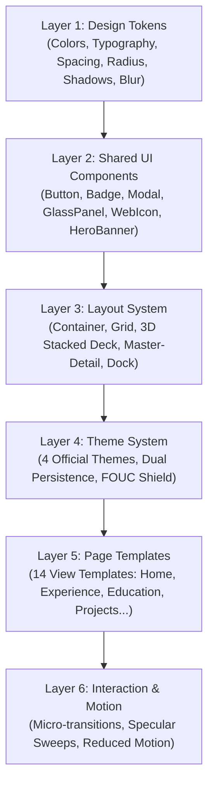

# MASTER DESIGN SYSTEM: MULTI-THEME GLASS & ADAPTIVE GOVERNANCE
**Hệ thống thiết kế:** Hung Thai Executive Portal  
**Quản lý kiến trúc:** 6-Layer Modular Design System Architecture  
**Phiên bản:** 2.0.0 — Comprehensive System Governance  
**Trạng thái:** Production Ready  

---

## 1. NGUYÊN TẮC THIẾT KẾ CỐT LÕI (CORE PRINCIPLES)

1. **Light Glassmorphism & Cosmic Neon Depth**: Bề mặt kính trong suốt với lớp mờ nền sâu (`backdrop-filter: blur(14px - 16px)`), viền kính sáng tinh khiết cho theme sáng và ánh hào quang Neon đa sắc cho theme tối.
2. **Harmonious Color Hierarchy**: Phối màu có thứ bậc rõ ràng: 70% màu nền trung tính/dịu mắt, 20% cho các bề mặt thẻ con và 10% dành cho các điểm nhấn màu nổi bật (Clay & Neon Accents).
3. **Smart Adaptive Card Layout**: Mọi thẻ và container đều tự động điều chỉnh chiều cao theo nội dung thực tế (`height: auto` hoặc `height: fit-content`), không ép cứng chiều cao, tự động xuống dòng tiếng Việt không cắt chữ.
4. **Zero Layout Distortion & Zero Horizontal Overflow**: Thiết kế tương thích hoàn toàn từ màn hình nhỏ nhất (360px) đến siêu rộng (4K), loại bỏ triệt để thanh cuộn ngang ngoài ý muốn.
5. **Multi-theme Coexistence & Isolation**: Đảm bảo 4 theme (`light-glass`, `light-glass-dashboard`, `flat-rainbow`, `dark-neon`) vận hành độc lập, không có xung đột CSS hay hiện tượng rò rỉ style.
6. **Subtle Micro-interactions & Reduced Motion**: Mọi chuyển động vi mô khi rê chuột đạt chuẩn 200–250ms với đường cong tự nhiên `cubic-bezier(0.16, 1, 0.3, 1)`, tôn trọng thiết lập `prefers-reduced-motion`.

---

## 2. KIẾN TRÚC 6 LỚP THIẾT KẾ (6-LAYER DESIGN SYSTEM ARCHITECTURE)

---

### LAYER 1: DESIGN TOKENS
Quản lý tập trung trong [src/styles/variables.css](file:///c:/Users/My%20Profile/.gemini/antigravity/scratch/cvnew/src/styles/variables.css):

#### 1.1. Color System (Đa Theme)
- **Theme Light Glass (`light-glass`)**:
  - Backgrounds: Lavender `#F5F3FF`, White `#FFFFFF`, Soft Blue `#EFF6FF`, Soft Green `#ECFDF5`, Soft Yellow `#FFFBEB`, Soft Coral `#FFF1F2`.
  - Accents: Clay Blue `#60A5FA`, Clay Green `#34D399`, Clay Yellow `#FCD34D`, Clay Coral `#FB7185`, Clay Purple `#A78BFA`.
  - Typography: Primary Ink `#1E1B4B`, Secondary Slate `#475569`, Muted `#64748B`.
- **Theme Light Glass Dashboard (`light-glass-dashboard`)**:
  - Backgrounds: Ice Blue `#EAF4FF`, Secondary `#F1F5FF`, Lavender `#F5F3FF`.
  - Accents: Electric Blue `#3B82F6`, Cyan `#22C1DC`, Green `#34D399`, Yellow `#FCD34D`, Purple `#A78BFA`.
  - Typography: Primary Navy `#1E3A6D`, Secondary `#58749A`, Muted `#7890B0`.
- **Theme Dark Neon (`dark-neon`)**:
  - Backgrounds: Deep Dark `#070A14`, Secondary `#0B1020`, Elevated `#11182B`, Deep `#080D19`.
  - Accents: Neon Cyan `#22D3EE`, Electric Blue `#3B82F6`, Neon Purple `#A855F7`, Neon Pink `#F472B6`, Neon Green `#34D399`.
  - Typography: Primary `#F8FAFC`, Secondary `#CBD5E1`, Muted `#94A3B8`.

#### 1.2. Glass Tokens
- Nền kính sáng: `rgba(255, 255, 255, 0.76 - 0.88)`
- Nền kính tối: `rgba(20, 28, 48, 0.62)`
- Độ nhòe (Blur): `14px - 16px` kết hợp `saturate(180%)`
- Viền kính sáng: `1.5px solid rgba(255, 255, 255, 0.88)`
- Viền kính tối: `1px solid rgba(255, 255, 255, 0.12)`

#### 1.3. Radius Tokens
- `--radius-sm`: `8px`
- `--radius-md`: `12px`
- `--radius-lg`: `16px`
- `--radius-xl`: `20px`
- `--radius-2xl`: `24px`
- `--radius-full`: `9999px`

---

### LAYER 2: SHARED UI COMPONENTS
- **`<Button>`**: Đa kích cỡ (sm, md, lg), đa biến thể (Primary, Secondary, Success, Warning, Danger, Ghost). Tích hợp hiệu ứng chạm nhẹ `scale-[0.98]` và focus ring rõ ràng.
- **`<Badge>`**: Thẻ nhãn thông số và tag phân loại, hỗ trợ đa sắc Clay và Neon.
- **`<GlassPanel>`**: Container kính dùng chung cho mọi thẻ nội dung.
- **`<Modal>`**: Cửa sổ tương tác nổi với lớp nền nhòe sâu, esc key binding và nút đóng an toàn.
- **`<ThemeSelectorModal>`**: Cửa sổ chọn 4 theme trực quan có thẻ xem trước và màu sắc đại diện.
- **`<WebIcon>`**: Thư viện biểu tượng vector SVG Lucide đồng bộ nét vẽ.
- **`<HeroBanner>`**: Cụm tiêu đề trang có nhãn nghệ thuật viết tay phân cấp rõ rệt.

---

### LAYER 3: LAYOUT SYSTEM
- **3D Interactive Layered Cards Deck**: Bố cục 3 thẻ xếp chồng (`HomeView`).
- **CodePen 3D Stack Deck**: Bố cục 14 thẻ xếp lớp lật mở chi tiết (`EducationView`).
- **2-Row Responsive Grid**: Bố cục lưới 2 hàng cho danh mục thẻ học vấn (`EducationView`).
- **Split Master-Detail Timeline**: Bố cục chia đôi cột thời gian và bảng chi tiết STAR (`ExperienceView`, `ProjectsView`).
- **Floating Capsule Navigation & Dock**: Thanh điều hướng treo capsule trên đỉnh và thanh dock tiện ích nổi dưới đáy.
- **Bento Grid**: Bố cục lưới phi đối xứng cho các thông số vận hành và kiến trúc hệ thống (`SystemsView`, `DomainsView`).

---

### LAYER 4: THEME SYSTEM
- **Theme Registry**: Đăng ký tập trung trong [`src/data/themes.ts`](file:///c:/Users/My%20Profile/.gemini/antigravity/scratch/cvnew/src/data/themes.ts) và [`src/types/index.ts`](file:///c:/Users/My%20Profile/.gemini/antigravity/scratch/cvnew/src/types/index.ts).
- **Cơ chế lưu trữ kép**: Khóa `portfolio-theme` và `hungthai_site_theme` trong `localStorage`.
- **FOUC Hydration Shield**: Script đồng bộ tức thì thuộc tính `data-theme` trước khi DOM kết xuất.
- **Hiệu ứng chuyển theme**: Lớp phủ quang phổ `.theme-vivid-overlay` phủ nhẹ trong 750ms.

---

### LAYER 5: PAGE TEMPLATES
- 14 Mẫu trang tương ứng với 14 màn hình nghiệp vụ (Trang Chủ, Thư Ngỏ, Giới Thiệu, Học Vấn, Lĩnh Vực, Kinh Nghiệm, Kỹ Năng, Dự Án, Hệ Thống, Phỏng Vấn, Tử Vi, Kỷ Niệm, Liên Hệ, Hình Nền).
- Đảm bảo khoảng đệm trên `pt-20` và khoảng đệm dưới `pb-28` cho hệ thống điều hướng nổi.

---

### LAYER 6: INTERACTION & MOTION
- **Micro-transitions**: 220ms - 250ms với đường cong `cubic-bezier(0.16, 1, 0.3, 1)`.
- **Card Lift**: Nâng nhẹ `translateY(-2px đến -4px)` khi hover.
- **Neon Glow**: Ánh hào quang tỏa rộng khi rê chuột trên thẻ nền tối (`box-shadow: 0 0 20px rgba(...)`).
- **Accessibility**: Tự động tắt toàn bộ chuyển động lớn khi phát hiện `@media (prefers-reduced-motion: reduce)`.
